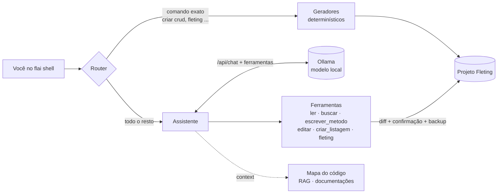

# FLAI — Framework Local de IA

**FLAI** é um assistente de desenvolvimento com IA que roda **100% na sua máquina**, feito
para projetos [Fleting](https://github.com/alexyucra/fleting) (Python + Flet, padrão MVC).
Ele usa modelos locais via [Ollama](https://ollama.com): seu código nunca sai do computador,
não há custo por uso e funciona offline.

```text
💬 Você: criar crud de usuarios com os campos: nome, email, ativo:bool
📋 Plano: CRUD 'usuarios'
  tabela: id, nome VARCHAR(255), email VARCHAR(255), ativo BOOLEAN
  1. preencher 002_usuarios.py com CREATE TABLE
  2. fleting db migrate
⚠️ Executar o plano? [s/N]: s
🔎 Verificação  ✅ view  ✅ migration aplicada  ✅ tabela no banco
Quer que eu crie a listagem de usuarios na usuarios_view?

💬 Você: sim
🔧 criar_listagem(entidade=usuarios)
✏️ editar app/views/pages/usuarios_view.py   (diff)
⚠️ Aplicar alteração? [s/N]: s
  ✅ salvo (/desfazer para reverter)
```

## Por que FLAI?

| | |
|---|---|
| 🔒 **Privado** | Nada é enviado para a nuvem. O modelo, o índice e o histórico ficam no seu disco. |
| 💸 **Sem custo** | Sem assinatura, créditos ou chave de API. |
| ✈️ **Offline** | Depois de baixar o modelo, funciona sem internet. |
| 🧩 **Especializado em Fleting** | Conhece a estrutura MVC, a CLI `fleting` e a versão do Flet do projeto. |
| 💻 **Hardware modesto** | Ajusta contexto e memória à RAM disponível. Roda em CPU com ~3 GB livres. |
| 🛡️ **Seguro** | Só acessa o projeto atual, mostra o diff de toda alteração, pede confirmação e permite desfazer. |

## O que ele faz

- **Conversa com memória:** lembra das últimas trocas e do assunto em foco. Dá para perguntar
  "e o model dele?" depois de falar do `usuarios_controller`.
- **Lê e altera o projeto:** lê arquivos, busca no código, cria ou reescreve métodos e edita
  trechos. Toda alteração passa por diff, validação de sintaxe e confirmação.
- **Geradores determinísticos:** CRUD completo (página, migration com `CREATE TABLE`, migrate e
  verificação) e listagem em tabela (`ft.DataTable`), confiáveis mesmo com modelos pequenos.
- **Comandos Fleting:** executa a CLI `fleting` (create, list, db, doctor) por uma allowlist.
- **Busca semântica (RAG):** indexa o código e documentações (Flet, Fleting, as suas) para
  respostas com contexto.
- **Controle de recursos:** mede a RAM, escolhe o contexto seguro e cria um modelo derivado
  ajustado (`flai-<modelo>:ctx<N>`).

## Começo rápido

```bash
# 1. Pré-requisitos: Python 3.11+ e Ollama (https://ollama.com/download)
pip install fleting flai-ia

# 2. Crie (ou entre em) um projeto Fleting
fleting init meu_app
cd meu_app

# 3. Configure a IA local (detecta hardware, baixa e otimiza o modelo)
flai init qwen2.5-coder:3b

# 4. Converse com o assistente
flai shell
```

!!! tip "Modelo recomendado"
    `qwen2.5-coder:3b` (~2,2 GB de RAM em uso) com `context_tokens: 8192`.
    Com menos de 4 GB livres, use `qwen2.5-coder:1.5b`. Veja [Modelos e desempenho](pt/modelos.md).

## Como está organizado



## Próximos passos

<div class="grid cards" markdown>

- **[Instalação](pt/instalacao.md)**: Python, Ollama, modelo e primeiro projeto.
- **[Comandos (CLI)](pt/cli.md)**: `flai init`, `shell`, `rag`, `context`, `history`, `config`.
- **[Assistente](pt/assistente.md)**: como a conversa, as ferramentas e a memória funcionam.
- **[Geradores](pt/geradores.md)**: CRUD, listagem e comandos Fleting.
- **[Modelos e desempenho](pt/modelos.md)**: escolha do modelo, RAM, velocidade e ajustes.
- **[Configuração](pt/configuracao.md)**: `.flai/config.json` e variáveis de ambiente.
- **[Arquitetura](pt/arquitetura.md)**: módulos, fluxo de uma mensagem e decisões de design.
- **[Segurança](pt/seguranca.md)**: sandbox do projeto, confirmações e allowlist.
- **[Solução de problemas](pt/solucao-de-problemas.md)**: erros comuns e diagnóstico.

</div>

---

FLAI é open source (licença MIT). Contribuições são bem-vindas: veja [Contribuir](pt/contribuir.md).
