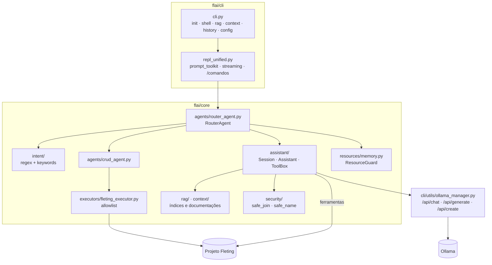
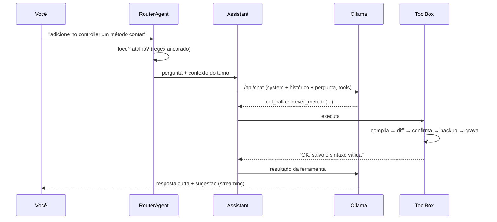

# Arquitetura

## Visão geral



| Módulo | Responsabilidade |
|---|---|
| `flai/cli/cli.py` | Comandos Click (`init`, `shell`, `rag`, `context`, `history`, `config`) |
| `flai/cli/repl_unified.py` | Loop do shell: entrada (prompt_toolkit), spinner, streaming, comandos `/`, histórico |
| `flai/core/agents/router_agent.py` | Decide atalho ou assistente; monta contexto do turno; prepara o modelo (RAM/tokens) |
| `flai/core/intent/` | `IntentPatterns` (regex ancorados), `IntentClassifier` (keywords), `IntentParser` |
| `flai/core/assistant/session.py` | Histórico, foco, arquivos recentes, pergunta pendente |
| `flai/core/assistant/assistant.py` | Loop de ferramentas com `/api/chat`, prompt com prefixo estável, `StreamGate`, orçamento |
| `flai/core/assistant/tools.py` | Ferramentas, diff/confirmação, validação de sintaxe, `BackupStore` (/desfazer), geradores |
| `flai/core/agents/crud_agent.py` | CRUD determinístico (diagnóstico, plano, execução, verificação) |
| `flai/core/executors/fleting_executor.py` | CLI `fleting` por allowlist; normalização de nomes |
| `flai/core/resources/memory.py` | `ResourceGuard`: RAM, KV cache por token, contexto seguro, `TokenPlan` |
| `flai/cli/utils/ollama_manager.py` | Descoberta/início do Ollama, modelos, `chat()` com tools e streaming, modelo derivado |
| `flai/core/rag/`, `flai/core/context/` | Índice do código e das documentações (Flet, Fleting, suas) |
| `flai/core/security/` | `safe_join` (confinamento de caminhos), `safe_name`, validação de URLs |

## Fluxo de uma mensagem



### 1. Roteamento

1. `fleting ...` → executor direto.
2. `sim`/`não` com sugestão pendente → a sugestão vira um comando ("Quer que eu crie X?" →
   "crie X") e vai para o assistente.
3. Regex **ancorados** (frase inteira ou padrões explícitos): `criar crud de X`,
   `criar página X`, `criar model X`, `ajuda`, `sair` → atalhos.
4. Todo o resto → assistente.

!!! note "Por que regex ancorados"
    Antes, `r"q"` (sair) casava com "verifi**q**ue" e `r"\?"` (ajuda) com qualquer
    pergunta. Comandos de controle agora só valem como frase inteira. Palavras-chave soltas
    nunca disparam `help`/`exit`.

### 2. Montagem do prompt (cache de prefixo)

O Ollama reaproveita o KV cache quando o **início** do prompt é idêntico ao da chamada
anterior. A ordem é escolhida para isso:

```text
[tools: definição das 10 ferramentas]          ← fixo
[system: regras + resumo do projeto + mapa]    ← muda só quando o código muda
[histórico: últimas 6 trocas]                  ← só cresce no fim
[pergunta + contexto do turno + dica]          ← novo a cada mensagem
```

- **Mapa do código:** cada `.py` de `app/` e `configs/` com classes e métodos, via `ast`.
  Poucas centenas de tokens para o projeto inteiro.
- **Contexto do turno:** foco, arquivo resolvido (citado pelo nome; "o model dele" com
  foco `usuarios` → `usuarios_model.py`; "corrija ele" → arquivo recente), trechos do RAG e
  das documentações.
- **Dica de ferramentas:** `(Ferramentas indicadas: ...)` no fim. A lista de tools fica fixa
  para não quebrar o cache, e chamadas fora da dica são recusadas com orientação.
- **Aquecimento:** ao abrir o shell, uma chamada com `num_predict: 1` carrega o modelo e
  processa o system prompt enquanto você digita.

### 3. Loop de ferramentas

Até 5 passos. Em cada um: `/api/chat` em streaming. Se vierem `tool_calls`, cada ferramenta é
executada e o resultado volta como mensagem `tool`. Proteções:

- **StreamGate:** segura o início da resposta se parecer JSON de ferramenta escrito como
  texto (comum em modelos pequenos), interpreta e executa. Texto normal passa direto.
- **Chamada repetida idêntica:** é bloqueada e o modelo é instruído a encerrar.
- **Orçamento:** `num_ctx − resposta − ferramentas (~1000) − margem`. Primeiro remove trocas
  antigas, depois encurta o maior contexto. O system nunca é cortado.
- **Honestidade:** se alguma escrita foi rejeitada ou cancelada, a resposta termina com
  `⚠️ Alteração NÃO aplicada`.

### 4. Recursos (RAM e tokens)

`ResourceGuard.plan()` calcula:

```text
KV por token = 2 × camadas × cabeças_kv × dim_cabeça × 2 bytes   (lido de /api/show)
contexto seguro = (RAM livre + RAM do modelo já carregado − folga − pesos − buffers) / KV por token
```

- A memória do modelo já carregado (base ou derivado `flai-*`) é somada de volta.
- A folga do sistema (1,5 GB) é preferência: se não couber, roda com folga mínima (0,25 GB)
  e avisa, em vez de bloquear.
- O modelo derivado `flai-<base>:ctx<N>` é criado uma vez via `/api/create`.

## Decisões de design

| Decisão | Motivo |
|---|---|
| Geradores determinísticos para CRUD e listagem | Modelos de 3B falham em tarefas de várias etapas; código fixo é confiável e instantâneo |
| `escrever_metodo` (método inteiro, indentação via `ast`) | Modelos pequenos erram indentação em edições de trecho |
| Validar a sintaxe **antes** do diff | O usuário só vê propostas válidas; o erro volta ao modelo para corrigir |
| Uma confirmação por plano | Menos interrupções sem perder controle |
| Temperatura 0.1 no loop de ferramentas | Escolha de ferramenta e argumentos precisam ser estáveis |
| Respostas curtas por padrão (≤ 768 tokens) | Na CPU (~15 tok/s), cada 100 tokens custam ~7 s |
