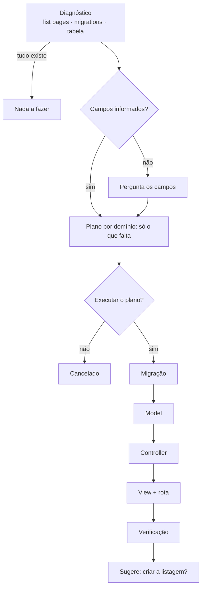

# Geradores: CRUD, listagem e comandos Fleting

Tarefas com várias etapas e formato conhecido são feitas por **código determinístico**, não
pelo modelo. O resultado é sempre igual, rápido e verificado. O modelo só decide **quando**
usar cada gerador.

## CRUD

```text
criar crud de produtos com os campos: nome, preco:float, estoque:int
```

Também é acionado pelo assistente (ferramenta `criar_crud`) quando você pede algo como
"vamos construir um crud de clientes".

### Fluxo por domínio

O CRUD é implementado **por domínio**, sempre nesta ordem, e cada etapa só roda se faltar:

| # | Domínio | O que faz |
|---|---|---|
| 1 | Diagnóstico | Equivalente a `fleting list pages` (model, controller, view, rota) + migrations e tabela |
| 2 | Migração | `fleting db init` (se preciso) · `fleting db make <nome>` + `CREATE TABLE` · `fleting db migrate` |
| 3 | Model | `fleting create model <nome>` |
| 4 | Controller | `fleting create controller <nome>` + métodos `listar`, `buscar`, `criar`, `atualizar`, `excluir` |
| 5 | View + rota | `fleting create page <nome>`: com model e controller prontos, cria só a view e registra a rota |
| 6 | Verificação | `fleting list pages` de novo, migration aplicada, tabela no SQLite, sintaxe dos arquivos |



- Repetir o pedido **não duplica nada**; se só falta a rota ou os métodos do controller, o
  plano tem só essa etapa.
- **Uma confirmação** para o plano inteiro, incluindo o `fleting db migrate`.
- Os campos só são pedidos se a tabela ainda não existe.

```text
  fleting list pages → produtos: model —  controller —  view —  route —
📋 Plano: CRUD 'produtos'
  tabela: id, nome VARCHAR(255), preco REAL
  1. migração: fleting db make produtos + CREATE TABLE
  2. migração: fleting db migrate
  3. model: fleting create model produtos
  4. controller: fleting create controller produtos
  5. controller: métodos listar, buscar, criar, atualizar, excluir
  6. view: fleting create page produtos (view e rota)
  7. verificação: fleting list pages, migration, tabela e sintaxe
⚠️ Executar o plano? [s/N]: s
  ✅ fleting db make produtos
  ✅ 004_produtos.py: CREATE TABLE produtos
  ✅ fleting db migrate
  ✅ fleting create model produtos
  ✅ fleting create controller produtos
  ✅ produtos_controller: métodos CRUD
  ✅ fleting create page produtos
🔎 Verificação
  fleting list pages → produtos: model ✔  controller ✔  view ✔  route ✔
  ✅ 10 verificações ok
Quer que eu crie a listagem de produtos na produtos_view?
```

### Tipos de campo

Informe com `nome:tipo` ou deixe o FLAI inferir pelo nome:

| Você escreve | SQL |
|---|---|
| `nome`, `email`, `nome:str` | `VARCHAR(255)` |
| `descricao`, `obs`, `bio`, `x:texto` | `TEXT` |
| `idade`, `quantidade`, `estoque`, `ano`, `cliente_id`, `x:int` | `INTEGER` |
| `preco`, `valor`, `salario`, `total`, `x:float` | `REAL` |
| `ativo`, `is_admin`, `tem_x`, `x:bool` | `BOOLEAN` |
| `data`, `nascimento`, `data_x`, `x:date` | `DATE` |
| `x:datetime` | `DATETIME` |

O `id` é criado automaticamente, compatível com SQLite (`INTEGER PRIMARY KEY AUTOINCREMENT`)
e MySQL/MariaDB (`INT AUTO_INCREMENT PRIMARY KEY`).

### Migration gerada

```python
from core.database import is_mysql


def up(db):
    pk = "INT AUTO_INCREMENT PRIMARY KEY" if is_mysql() else "INTEGER PRIMARY KEY AUTOINCREMENT"
    cur = db.cursor()
    cur.execute(f'''
        CREATE TABLE IF NOT EXISTS produtos (
            id {pk},
            nome VARCHAR(255),
            preco REAL,
            estoque INTEGER
        )
    ''')
    cur.close()


def down(db):
    cur = db.cursor()
    cur.execute("DROP TABLE IF EXISTS produtos")
    cur.close()
```

## Listagem

```text
crie a listagem de produtos na produtos_view
```

Ou responda `sim` à sugestão feita após o CRUD. A ferramenta `criar_listagem`:

1. lê as colunas do `CREATE TABLE` da migration da entidade;
2. adiciona `listar()` ao controller, se não existir:
   ```python
   def listar(self):
       return self.model.all()
   ```
3. reescreve o `render()` da view com um `ft.DataTable`:

```python
def render(self):
    try:
        rows = self.controller.listar()
        error = None
    except Exception as e:  # tabela ainda não migrada, banco indisponível...
        rows, error = [], str(e)

    table = ft.DataTable(
        columns=[
            ft.DataColumn(label=ft.Text("Nome")),
            ft.DataColumn(label=ft.Text("Preco")),
        ],
        rows=[
            ft.DataRow(cells=[
                ft.DataCell(ft.Text(str(row.get("nome", "")))),
                ft.DataCell(ft.Text(str(row.get("preco", "")))),
            ])
            for row in rows
        ],
    )
    ...
```

Cada arquivo passa por diff e confirmação, e pode ser revertido com `/desfazer`.

## Comandos Fleting

Escreva o comando direto ou peça em linguagem natural ("liste as páginas", "rode o doctor").

| Comando | Confirmação |
|---|---|
| `fleting create page\|view\|model\|controller <nome>` | não |
| `fleting list pages\|views\|models\|controllers` | não |
| `fleting list routes` | **sim** (importa código do projeto) |
| `fleting db init\|make <nome>\|status` | não |
| `fleting db migrate\|rollback\|seed` | **sim** (executa código do projeto) |
| `fleting delete page\|view\|model\|controller <nome>` | **sim** (apaga arquivos) |
| `fleting info`, `fleting doctor` | não |
| `fleting run`, `fleting init` e qualquer outro | **bloqueado** |

Nomes são normalizados (`Ordem-Compra` → `ordem_compra`). Nomes com `../`, comandos fora da
allowlist e argumentos extras são recusados. Veja [Segurança](seguranca.md).
