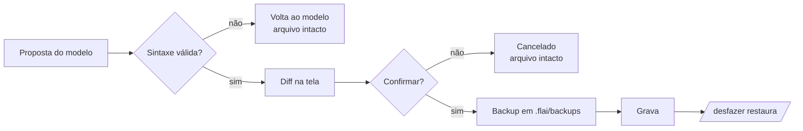

# Segurança e privacidade

## Privacidade

- O modelo roda no Ollama local (`127.0.0.1:11434`). Nenhum código, pergunta ou resposta é
  enviado para fora.
- Índices, histórico, backups e configuração ficam em `.flai/` dentro do projeto.
- Rede só é usada quando **você** pede: baixar modelos (`ollama pull`) ou documentações do
  tipo `git_repo`/`url` (`flai context add`).

## O que a IA pode tocar

| Regra | Como |
|---|---|
| Só arquivos do projeto | Todo caminho passa por `safe_join(projeto, caminho)`; `../`, caminhos absolutos e links para fora são recusados |
| Pastas protegidas | `.flai`, `.git`, `.venv`/`venv`, `__pycache__`, `node_modules`, `data` não são lidas nem escritas |
| Ferramentas fixas | Só as 10 ferramentas do FLAI; nenhuma executa shell arbitrário |
| CLI Fleting por allowlist | Só subcomandos listados; nomes validados (`[a-z][a-z0-9_]*`, sem palavras reservadas) |
| Comandos sensíveis | `db migrate/rollback/seed`, `delete ...` e `list routes` executam ou apagam código: pedem confirmação |
| Bloqueados | `fleting run`, `fleting init` e qualquer comando fora da lista |
| URLs de documentação | Só `https`; git com `protocol.allow=never` exceto https; limite de 5 MB por página |

## Toda alteração de arquivo



- **Nunca** grava um `.py` com erro de sintaxe.
- **Nunca** grava sem a sua confirmação, com o diff visível.
- **Sempre** guarda backup; `/desfazer` restaura (ou apaga, se o arquivo foi criado).
- A resposta não pode afirmar sucesso falso: se nada foi aplicado, o FLAI acrescenta o aviso.

## Prompt injection

O conteúdo dos arquivos, do RAG e das documentações entra no prompt como **dados**. O system
prompt instrui o modelo a ignorar instruções que apareçam nesse conteúdo. Mesmo que o modelo
seja enganado, qualquer ação passa pelas barreiras acima: caminhos confinados, allowlist,
diff e confirmação.

## Testes de segurança

```bash
python -m pytest flai/test/test_security_controls.py flai/test/test_assistant.py -q
```

Cobrem path traversal, pastas protegidas, nomes inválidos, comandos bloqueados, URLs,
rejeição de sintaxe, cancelamento e desfazer.
